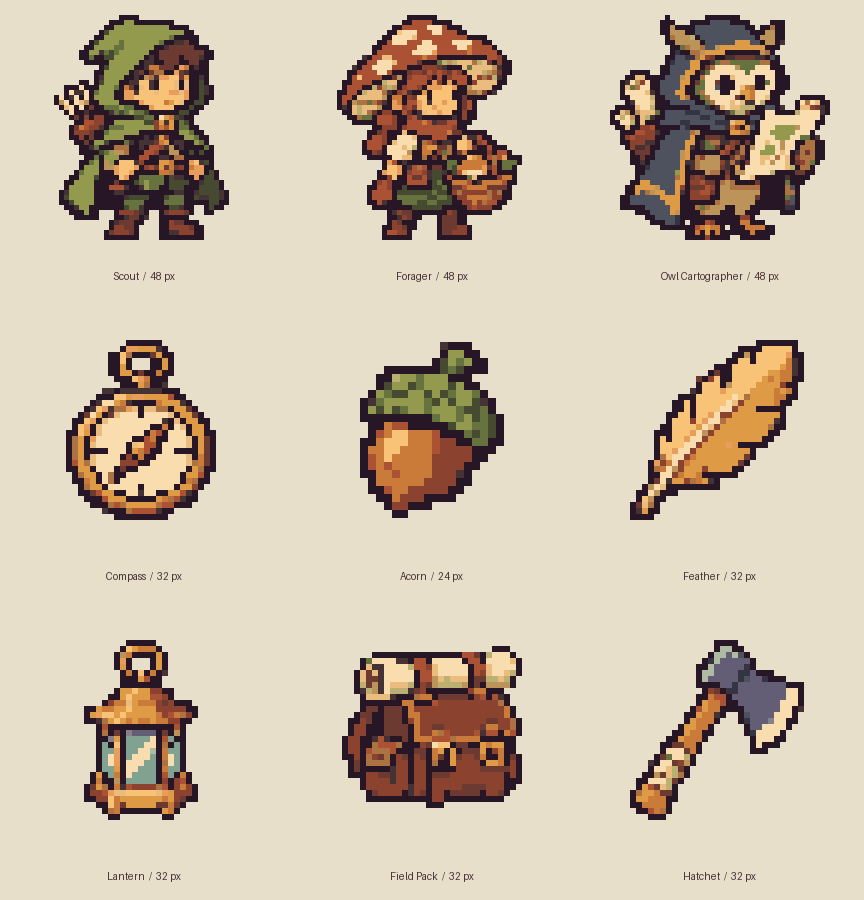

# Pixel Asset Pipeline

게임 제작의 **2D 아트 에셋 제작**을 맡는 개인용 Codex 플러그인·스킬이다. 0.2에서는 정적 스프라이트 외에 장비 변형, 세트 비교, 동작 시트, 반복 타일과 절차적 이펙트를 로컬에서 만들 수 있다. 게임 엔진과 게임 규칙은 호출하는 호스트가 맡는다.

[제작 계획·완료 기록](docs/asset-production-plan.md) · [제작 요청 규격](.agents/skills/pixel-asset-pipeline/references/production.md) · [에셋 미리보기](examples/production/index.html)



## 게임 제작에서의 위치

| 레이어 | 소유자 | 입출력 |
| --- | --- | --- |
| 게임 기획·시스템 | 상위 앱 제작 플러그인의 게임 모듈 | 어떤 캐릭터·아이템이 필요한지 정한다. 프로젝트 공통 팔레트·시점·스타일을 관리한다. |
| **2D 아트 제작** | **이 플러그인** | 요청과 공유 스타일을 읽어 초안을 만들거나 받는다. 크기·팔레트·알파·기준선을 정리하고 기술 검증을 통과한 번들을 반환한다. |
| 엔진 임포트·플레이 | 상위 플러그인의 엔진 어댑터 | 원본 크기 PNG를 게임에 복사하고 배치 기준점·필터를 적용한다. 애니메이션 상태, 인벤토리 데이터, 씬 연결, 엔진 내 QA를 소유한다. |

게임 엔진과 호스트 언어가 바뀌어도 파일 계약은 동일하다. [모의 게임 플러그인](examples/mock-game-plugin/import.mjs)이 계약을 사용하는 최소 실행 예이다.

## 에셋을 씬에서 확인하기

[이끼숲 순찰길](examples/forest-scene/index.html)은 스킬이 납품한 PNG와 피벗을 소비하는 검증용 브라우저 예제다. 프로젝트 루트에서 로컬 서버를 실행하고 [씬 열기](http://127.0.0.1:8848/forest-scene/)로 접속한다.

```sh
.venv/bin/python -m http.server 8848 --bind 127.0.0.1 --directory examples
```

좌우 방향키나 화면의 화살표를 길게 눌러 아이템 세 개를 수집한다. **발 위치 검사**를 켜면 씬의 바닥선과 원본 48×48 격자의 피벗을 함께 볼 수 있다. **화면 배율 → 원본 1×**로 실제 크기를 확인할 수 있다. 소스와 배경은 모두 `examples/forest-scene/`에서 관리한다. 걷는 동안에는 실제 4프레임 시트를, 수집 순간에는 1회성 이펙트 시트를 재생한다. 정지 상태와 피벗 검사에는 기존 원본 PNG를 사용한다.

[0.2 실제 시트 플레이 녹화](examples/forest-scene/evidence/sheet-play.mp4) · [0.1 피벗 검사 화면](examples/forest-scene/evidence/foot-inspection.png)

## 바로 실행하기

Python 3.10 이상과 Pillow 10~12가 필요하다. 현재 작업 폴더에는 준비한 가상 환경이 있다. 사내 장비에서는 승인된 로컬 Python·Pillow 환경에 CLI를 설치하거나 아래처럼 소스에서 직접 실행한다. 후처리 과정에서 설치·다운로드하지 않는다.

```sh
.venv/bin/pixel-asset build --request examples/woodland/scout.request.json \
  --draft examples/codex-scout/draft.png --out /tmp/woodland-scout
.venv/bin/pixel-asset validate --request examples/woodland/scout.request.json /tmp/woodland-scout/asset.png
```

초안부터 새로 만들려면 ChatGPT로 로그인한 Codex CLI를 사용한다. 생성할 때 Codex에 보내는 것은 제작 설명·스타일과 코드로 그린 배치 가이드다. 스타일 참조는 `--style-reference`로 지정한 PNG에 한해 메타데이터를 지우고 크기를 제한한 사본을 추가한다. 이 선택지를 생략하면 이미지 레퍼런스 없이 스타일 파일의 색상과 텍스트를 활용한다.

```sh
.venv/bin/pixel-asset build --request examples/woodland/scout.request.json \
  --codex --style-reference examples/woodland/sprites/scout.png --out /tmp/new-scout
```

`--draft`는 로컬 전용이다. `--codex`는 네이티브 이미지 도구만 쓰는 별도 Codex 세션을 실행한다. 외부 스킬·업체 서버·텔레메트리 연결을 구현하지 않았고, 별도 API 키를 읽거나 실패 시 다른 공급자로 넘기는 경로도 없다. Codex 프로세스에는 API 키·사용자 지정 서비스 URL·프록시 환경을 전달하지 않는다. 사내 자료를 완전히 오프라인으로 처리해야 하면 준비된 PNG와 `--draft`를 사용한다.

## 같은 게임에서 재사용하기

게임마다 [스타일 프로필](examples/woodland/style.json) 하나를 두고, [개별 요청](examples/woodland/scout.request.json)의 `profile`로 참조한다. 상대 경로는 요청 파일 기준이다. 요청에 같은 필드를 지정하면 해당 에셋에서만 재정의한다.

| 유형 | 기본 크기 | 색 수 상한 | 배치 |
| --- | --- | --- | --- |
| character | 48×48 | 16 | 발 아래 투명 2px |
| icon | 24×24 | 12 | 가운데 |
| item | 32×32 | 24 | 가운데 |

모든 크기는 8~256px 정사각형으로 지정할 수 있다. `max_colors`는 유형 상한까지 줄일 수 있다. `outline`은 선택 사항이며 팔레트 색으로 1px 외곽선을 보강한다. 알파를 가진 초안을 준비하고, 불투명 배경·빈 그림·손상된 PNG는 오류로 처리한다.

## 0.2 제작 예제

로컬 서버가 실행 중이면 [에셋 검수 페이지](http://127.0.0.1:8848/production/)에서 걷기·반짝임·불꽃 재생, 장비 비교와 반복 배치를 볼 수 있다. 아래 출력 경로는 비어 있는 새 경로를 사용한다.

```sh
.venv/bin/pixel-asset variant --request examples/production/gear/staff.request.json --out /tmp/scout-staff
.venv/bin/pixel-asset compare --request examples/production/set/compare-best-v2.json --out /tmp/scout-set
.venv/bin/pixel-asset sheet --request examples/production/walk/request.json --out /tmp/scout-walk
.venv/bin/pixel-asset tile --request examples/production/tiles/grass-request.json --out /tmp/grass-tile
.venv/bin/pixel-asset effect --request examples/production/effects/pickup/request.json --out /tmp/pickup-flash
```

기술 검사는 포즈의 픽셀·피벗·재생 시간, 팔레트, 장비가 바꾼 영역, 타일 경계 대비를 측정한다. 같은 아트 스타일인지, 원본 크기에서 동작이 자연스러운지는 실제 비교판과 재생 결과로 판단한다.

## 플러그인 및 호스트 계약

현재 소스에서 아래 명령으로 로컬 설치용 폴더를 만든다. 로컬 설치 폴더는 플러그인·스킬과 제작 계약·자체 Python 소스·패키지 메타데이터를 포함한다. 게임 예제와 테스트는 소스 저장소에 둔다.

```sh
python3 scripts/package-plugin.py /absolute/new/pixel-asset-package
codex plugin marketplace add /absolute/new/pixel-asset-package
codex plugin add pixel-asset-pipeline@pixel-asset-pipeline
```

프로젝트에서는 `$pixel-asset-pipeline`으로 호출한다. 설치된 플러그인의 스킬 이름은 `pixel-asset-pipeline:pixel-asset-pipeline`이다. 캐시된 플러그인의 지침을 사용할 때는 같은 설치본의 CLI를 준비된 Python으로 `PYTHONPATH="$PLUGIN_ROOT/src" "$PYTHON" -m pixel_asset_pipeline.cli ...`를 실행한다. 공유할 때는 [라이선스 검토 기록](docs/license-review.md)의 배포 범위를 확인한다.

### 설치된 스킬 업데이트

프로젝트에서 직접 쓰는 스킬의 원본은 [SKILL.md](.agents/skills/pixel-asset-pipeline/SKILL.md)다. 캐시로 설치한 플러그인은 새 버전을 별도로 등록한다. 이전에 등록한 버전을 별도 경로의 0.3.2로 교체하는 절차는 아래와 같다. 등록을 교체하기 전에 새 폴더 생성을 먼저 마친다.

```sh
python3 scripts/package-plugin.py /absolute/new/pixel-asset-0.3.2
codex plugin marketplace remove pixel-asset-pipeline
codex plugin marketplace add /absolute/new/pixel-asset-0.3.2
codex plugin add pixel-asset-pipeline@pixel-asset-pipeline
codex plugin list --marketplace pixel-asset-pipeline --json
```

마지막 출력의 installed 항목에서 `version`과 `enabled`를 확인한다. 개발 시 CLI 명령·제작 계약·검수 방법의 변경은 같은 커밋의 스킬 지침에 반영한다. 설치용 스킬의 모든 명령과 대표 로컬 예시는 `.venv/bin/python -m unittest discover -s tests -p test_skill_contract.py -v`로 검사한다.

**호출자는 생성 방식과 비어 있는 새 번들 경로를 지정한다.** 성공 시 종료 코드 0과 stdout 한 줄의 JSON을 받는다.

```json
{"schema_version":1,"status":"ready","files":{"sprite":"asset.png","preview":"preview.png","metadata":"metadata.json","validation":"validation.json","source":"draft.png"}}
```

`ready`는 기술 검사 통과를 뜻한다. PNG는 정수배 nearest-neighbor로 표시한다. `metadata.json`의 `import.pivot_px_from_top_left`는 원본 크기 좌상단에서 잰 픽셀 좌표이다. 호스트는 이를 자기 엔진 기준으로 변환한다. `visual_review`는 사람이 외형을 확인할 때까지 `pending`이다. build 오류는 종료 코드 2, 독립 validate의 규격 실패는 종료 코드 1이다. 출력 폴더는 성공한 경우에만 게시한다.

아래 명령은 어떤 게임 엔진도 설치하지 않고 호스트 어댑터를 실행한다. 목적지의 상위 폴더는 이미 존재해야 하며, 기존 게임 에셋은 덮어쓰지 않는다.

```sh
PIXEL_ASSET_CLI="$PWD/.venv/bin/pixel-asset" node examples/mock-game-plugin/import.mjs \
  examples/woodland/scout.request.json /tmp/game-scout.png examples/codex-scout/draft.png
```

## 검증과 출처

```sh
.venv/bin/python -W error -m unittest discover -s tests -v
.venv/bin/python examples/woodland/rebuild.py
```

[아홉 개의 결과](examples/woodland/results.json)는 Codex 내장 도구가 생성한 [한 장의 아틀라스](examples/woodland/atlas.png)를 로컬에서 분리하고 검증한 것이다. 샘플을 요구한 [생성 프롬프트](examples/woodland/atlas-prompt.txt)도 함께 보존했다. 독립 CLI 생성 실행의 [48px 정찰병](examples/codex-scout/asset.png)은 별도 결과다. 팔레트만 사용한 첫 실행에서는 몸이 길게 나왔다. 같은 요청에 기존 정찰병을 스타일 참조로 고른 [두 번째 실행](examples/codex-scout-styled/preview.png)에서는 후드와 머리가 더 크게 읽힌다. 두 에셋 모두 기술 검사를 통과했고 게임 내 시각 승인은 별도 단계로 남는다.

[벤치마킹 자료](docs/references.md)에 반영한 부분과 나중에 검토할 기능을 모두 남겼다. 실제 앱 제작 플러그인·게임 엔진과의 통합은 해당 호스트가 제공될 때 검증한다.

## 3D 소품 제작

[Model Assets](plugins/model-assets/README.md)는 같은 저장소에서 독립 설치한다. Blender에서 만든 편집 원본과 컴파일된 GLB를 납품하고 Three.js로 실제 로딩·렌더링을 검사한다. 픽셀 플러그인의 배포 파일 목록과 설치 캐시는 별개다. 게임에서의 에셋 사용·배치·검증은 스튜디오 프로젝트의 SSOT 그래프에 연결한다.

## 6동작 세트와 pixelfx

`pixel-asset action-set --request actions.json --out scout-actions`는 로컬 프레임을 대기·걷기·달리기·공격·점프·피격으로 묶는다. pixelfx로 만든 효과 시트와 JSON을 접촉 프레임에 연결하고 원본 고지를 납품한다. [입력 계약](.agents/skills/pixel-asset-pipeline/references/production.md#action-set--캐릭터-6동작과-접촉-효과) · [Agent Sprite Forge 검토](docs/sprite-forge.md)
